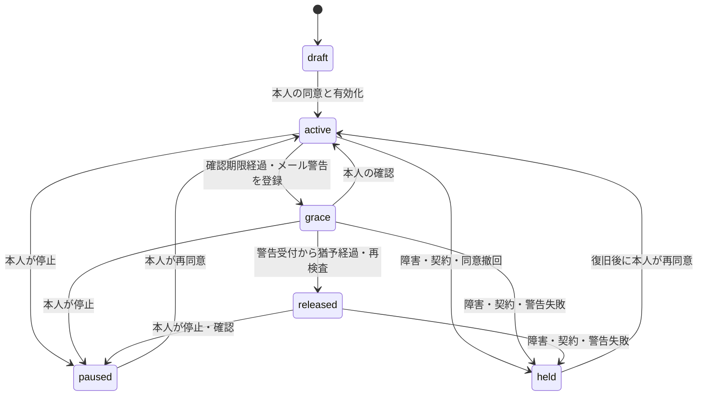

# 運用・デプロイ

## 本番リソースと設定

サーバー基盤はVoidから自分のCloudflareアカウントへデプロイします。`void.config.ts` にWorker名・カスタムドメインを設定し、VoidがD1・Cron・Queueを準備します。本作業では本番リソースの作成・デプロイは実施していません。

1. `bunx void connect --platform cloudflare` で本番の接続先を選ぶ。
2. `void.config.ts` の `email.from` に実送信元を設定し、[配信設定](integrations.md)に従ってWorkers PaidとEmail Sendingを有効にする。
3. 以下の本番環境変数を `bunx void secret put NAME` で登録する。`env.ts` が検証する。ローカルの `.env` は本番へ自動アップロードされない。
4. Cloudflareの独立した監視Workerなどから `POST /internal/probe` を毎分実行する。監視対象Worker自身のCronからプローブを自己実行しない。
5. Expo、Apple／Googleの商品・鍵・Webhookを設定する。
6. Email Sendingの配信イベントを `email-events` Queueへ接続する。受信するイベントは[配信設定](integrations.md)を参照する。

| 変数                  | 内容                                                 |
| --------------------- | ---------------------------------------------------- |
| `APP_ENV`             | `production`                                         |
| `NOTIFICATION_DRIVER` | `native`                                             |
| `BETTER_AUTH_URL`     | APIのHTTPS origin                                    |
| `TRUSTED_ORIGINS`     | 許可するWeb・HTTPSアプリリンクのoriginをカンマ区切り |
| `RECIPIENT_WEB_URL`   | 同居する受取WebのHTTPS origin                        |
| `EMAIL_FROM`          | Void設定と一致する認証済み送信元                     |
| `DELIVERY_ENABLED`    | 初期 `false`。本番接続・監視試験完了後のみ `true`    |

本番専用の `BETTER_AUTH_SECRET`、`ENCRYPTION_KEYS`、`ENCRYPTION_KEY_ID`、`WEBHOOK_SECRET`、`OPERATIONS_SECRET` を新規生成して登録します。`ENCRYPTION_KEYS` は `{"v1":"32バイト乱数のBase64"}`、`ENCRYPTION_KEY_ID` は `v1`。その他の秘密鍵は32文字以上の乱数です。

```sh
bun run check
bun run build
bun run test:runtime
bun run deploy
```

`deploy` は `void deploy --platform cloudflare --require-email` を実行し、DB作成、マイグレーション、Workerの公開をVoidが管理します。`--require-email` は一般利用者への送信可能性までは保証しません。Workers Paidの任意宛先送信を別途確認します。`void.lock.json` に記録されたリソースIDはコミットして保持してください。名前付き環境は使わず、開発と本番はVoidの別プロジェクトで分離します。

D1の配置ヒントは日本国内固定の保証ではありません。データ所在地・バックアップの保管条件は本番導入時の確認事項です。旧構成での東京限定という説明は引き継ぎません。[D1の配置](https://developers.cloudflare.com/d1/configuration/data-location/)

本番は`DELIVERY_ENABLED=false`でも復旧・受信者認証・連絡先確認・招待・自分宛テストは送られます。停止スイッチの対象は自動監視の警告・日常プッシュ・最終通知です。Cronは公開済みを含む監視を保留してリンクを失効させます。受取APIのpreview/readもCronを待たずに停止スイッチ・所有者の内部entitlement有効期限/状態・監視の最終tick/probe（5分以内）とincidentを同一の競合検査付きD1バッチ内で検査し、停止中は404で開示を拒否します。復号後と返却直前も期限を再検査します。受取人の辞退・通報は停止中も受け付けます。外部通知を全面停止する場合はCronの配信処理も停止し、Cloudflareメールの送信binding・Expoの送信資格情報を無効化してください。

## 状態と取消境界



`released`は本文・宛先の固定と通知準備を表します。全通知の配信成功ではありません。宛先ごとの`pending/sending/accepted/delivered/failed/uncertain/cancelled`を別に確認します。

D1の `batch()` とversionで、確認・停止・公開生成を原子的に確定します。`src/db/client.ts` の `atomic()` は読取開始時の全体revisionをコミット時に検査し、競合した計画を再構築します。すべてのアプリテーブルのINSERT／UPDATE／DELETE triggerがrevisionを進め、ヘルパー外の書き込みも検知します。D1のコールバック型トランザクションは使用しません。計画内で外部送信やRETURNINGを実行せず、同じ計画内の変更は計算済みの値で扱います。新規テーブルには3種類のtriggerが必須で、網羅性をテストしています。公開と受信者の組み合わせ、Outboxの論理キーを一意にします。送信直前に現在のversion、契約、状態、受取承諾、期限、監視状態を再検査して`sending`を確定します。

外部ネットワークへの送信中はDBロックを保持しません。`sending`の確定後に本人が停止した場合、既に開始した通知の到達は防げない場合があります。その場合も閲覧リンクは失効します。受信者が既に保存した内容は取り消せません。全過程のexactly-onceは保証しません。

## 障害対応

`/internal/status`を独立した監視から確認し、以下にアラートを設定します。

- Cronの`lastTickAt`、確認APIの`lastProbeAt`が5分を超えて古い
- `incidentAt`が存在する
- `uncertain`または`failed`の通知が存在する
- `pending`の滞留、特に認証リンク・警告メール
- 契約停止・宛先拒否・警告不達で`held`へ移った利用者（DB監視または監査イベント）

APIプローブはWorker内Cronから自己実行しません。独立した経路で本人確認APIの到達性を監視するためです。外部監視には必要最小限の`OPERATIONS_SECRET`を安全に設定します。秘密鍵をクエリ文字列へ含めません。

復旧手順:

1. 必要なら`DELIVERY_ENABLED=false`へ切り替える。送信中リクエストの取消までは保証しない。
2. Void Worker、D1、Cloudflare Email、独立プローブを修復する。
3. `uncertain`を事業者のログと照合し、信頼できるQueueイベントまたは署名付き運用イベントで確定する。確認できないものを再送しない。
4. Cron・外部プローブが新しい時刻へ進み続けることを確認する。
5. `DELIVERY_ENABLED=true`へ戻し、運用資格情報で`POST /internal/recover`を呼ぶ。
6. 保留した本人に状況を案内し、本人の確認・条件への再同意・有効化を経て再開する。APIは一括再開しない。

メール警告が不達・未確定のままなら猶予終了による公開は進みません。保留中でも本人による書き出し・停止は可能です。編集・主要APIの利用には有効な契約が必要です。プローブの欠落閾値は5分であり、それより短い障害時間の自動補償は行いません。

## 暗号鍵・データ

AES-256-GCM、毎回ランダムな96ビットIV、レコード用途とIDをAADに使用します。保存値に鍵IDを含みます。鍵をDBに保存せずVoidの本番Secretsへ配置します。これはサーバーで復号できる暗号化で、E2EEではありません。

暗号化するものは本文、宛先の名前・メール・電話、端末トークン、送信前の通知内容、ストア購入トークン・取引参照。Better Authの本人メール、セッション・認証情報、認証用verificationレコードは同ライブラリの保存形式です。本人メールの検索・ログインのため全PIIをアプリ側暗号化する設計ではありません。マジックリンクの認証トークン識別子と、端末用Bearerトークンはハッシュ化します。連絡先確認中のメールも暗号化し、確認トークンはハッシュ化します。端末トークンは180日、連絡先確認トークンは10分で期限切れになり、Cronで期限切れ行を削除します。

新規鍵へ切り替える場合、`ENCRYPTION_KEYS`に新旧を同時登録してから`ENCRYPTION_KEY_ID`を更新します。旧鍵で保存された本文・宛先がある間は旧鍵を削除しません。既存全レコードの一括再暗号化ツールは未実装です。バックアップと旧鍵はセットで復元できるよう保管します。鍵を失うと本文を復旧できません。サブスクの購入トークン・取引参照も同じ鍵で暗号化しているため、再検証の復旧にも鍵が必要です。

受付済み通知の暗号化payloadは消去します。公開スナップショットは30日で閲覧期限切れとなり、Cronで本文を消去します。下書き・停止・契約失効後の元本文には自動保存期限を設けていません。本人による削除を提供します。削除は関連テーブルへcascadeしますが、送信中の外部リクエストや事業者の保存履歴、既存バックアップは別の保持ポリシーが必要です。

Workersの標準Observabilityは無効です。本番で監視を追加する際もURLのquery、認証トークン、本文、メール、電話番号をログへ送らない設定を維持してください。ゲートウェイエラーにはHTTPステータスと例外種別だけを記録します。ローカルVoidの認証URLログ・受信箱は本番で収集しません。

## バックアップ・復元試験

本番稼働前に、D1 Time Travel／SQL書き出しとバックアップと鍵バックアップを用意し、別の非公開D1に復元して検証してください。テストでは`DELIVERY_ENABLED=false`、実通知の資格情報なし、全対象を保留にして始めます。復元したBetter Authセッション・device_credentials・contact_verifications・認証リンクは失効させ、通知台帳を本番事業者の受付履歴と照合し、既送信通知を再送しないことを確認します。

サービス/APIテストに加え、VoidローカルD1のマイグレーション、React Email、メール確認・復旧・削除、実workerdでのApple偽造署名拒否を検証します。本番D1のTime Travel復元、鍵の災害復旧、実メールのバウンス・プッシュ・ストア購入は本番接続後の検証事項です。

## 処理量

`crons/monitor.ts` は毎分、profileを100件ずつページングし、D1 Outboxの通知を最大50件まで順次処理します。Expo通信は10秒でタイムアウトし、メールの受付期限はVoid側が管理します。`queues/email-events.ts` はメール配信結果を処理します。送信ジョブ自体はD1 Outboxで管理します。

revisionはDB全体で共有するため、負荷が高い場合は競合再試行が増えます。8回で `503 DATABASE_BUSY` を返し、安全側に停止します。利用拡大前にD1サブリクエスト数、バッチ内のSQL数、競合率とCron処理時間を測定してください。

有効サブスクは6時間ごとに再検証し、確認が24時間途切れると権利を延長しません。通知・決済のWebhook監視も設定し、購入トークンやストアJWSをログに記録しないでください。

## 機種変更の復元設定

同じストア内の購入復元を使用します。初回購入は必ず本人端末の認証付き`/v1/billing/verify`で完了させてから、StoreKitのfinish等を行います。Webhookだけの到達では復元用の所有者確認を完了したと扱いません。

マイグレーション`0005`は`store_subscriptions.owner_verified_at`を追加します。以前の行は安全のためnullのままです。既存端末で`/v1/billing/verify`を再実行すると所有者を確認でき、新端末の復元が可能になります。nullを一括で埋める運用はしないでください。実ストアでは初回購入、サーバー検証、新端末で復元、旧端末拒否、新端末プッシュ再登録を確認します。
