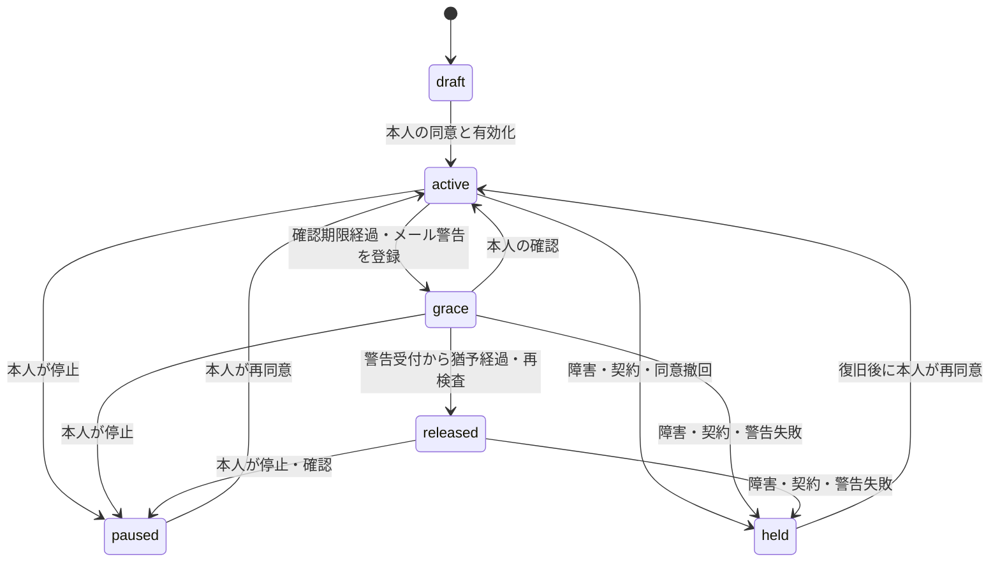

# 運用・デプロイ

## 本番リソース

1. Tursoで東京プライマリのグループとDBを作る。利用中のCLI/ダッシュボードで東京ロケーション（`nrt`）の提供状況を確認する。`turso group create --help`と`group show`で現在のオプション・配置を確認し、国外レプリカを追加しない。
2. DB URL・権限を絞った認証トークンを準備する。マイグレーション用資格情報はデプロイ処理だけで使用する。
3. Cloudflareのカスタムドメイン・日本向けAPIを設定する。`workers.dev`とPreview URLは無効のままにする。
4. Resendの送信ドメイン・Webhook、Expo Push Securityを設定する。送信元のドメイン認証、事業者の地域・保存条件を確認する。SMSは次期フェーズ対応のため、本番準備には含めない。
5. 実装済みのApple/Google検証器へ鍵・商品設定を登録し、対象商品の初月無料オファーを設定する。両ストアのWebhook、受信者Web、ExpoのHTTPSアプリリンクを接続する。
6. 独立した外部監視を1分間隔で`POST /internal/probe`へ接続し、CronとOutboxも監視する。

本番アカウントはこの作業では作成していません。DBの所在地はURLや`TURSO_LOCATION`だけから検証できません。管理プレーンでプライマリ、レプリカ、バックアップの配置・保持契約を確認した記録を残してください。

[Turso group作成](https://docs.turso.tech/cli/group/create) / [DB作成](https://docs.turso.tech/cli/db/create) / [Workers配置](https://developers.cloudflare.com/workers/configuration/placement/)

## Worker設定

`wrangler.jsonc`の`env.production`にカスタムドメインと以下の環境変数を設定します。URLの実値を公開リポジトリに置けない場合はSecretsとして登録できます。

| 変数                 | 内容                                                       |
| -------------------- | ---------------------------------------------------------- |
| `APP_ENV`            | `production`                                               |
| `BETTER_AUTH_URL`    | APIのHTTPS origin                                          |
| `TRUSTED_ORIGINS`    | 許可するWeb・HTTPSアプリリンクのoriginをカンマ区切りで列挙 |
| `RECIPIENT_WEB_URL`  | 受信者・本人WebのHTTPS origin                              |
| `TURSO_DATABASE_URL` | 東京DBのlibsqlまたはHTTPS URL                              |
| `TURSO_LOCATION`     | `nrt`。所在地の宣言値                                      |
| `DELIVERY_ENABLED`   | 初期`false`。本番接続・監視の試験完了後のみ`true`          |

Resend/ExpoとApple/Googleの資格情報・設定は[配信・ストア連携](integrations.md)の一覧も登録してください。Resend・ストアの秘密鍵を開発用キャプチャへ渡さず、本番では`NOTIFICATION_DRIVER=native`を使用します。

次のSecretsを**本番用に新しく**生成して登録します。`.dev.vars`の値を再利用しません。

```sh
bunx wrangler secret put TURSO_AUTH_TOKEN --env production
bunx wrangler secret put BETTER_AUTH_SECRET --env production
bunx wrangler secret put ENCRYPTION_KEYS --env production
bunx wrangler secret put ENCRYPTION_KEY_ID --env production
bunx wrangler secret put WEBHOOK_SECRET --env production
bunx wrangler secret put OPERATIONS_SECRET --env production
```

`NOTIFICATION_GATEWAY_URL`と`NOTIFICATION_GATEWAY_SECRET`はローカル通知キャプチャ用で、本番では不要です。

`ENCRYPTION_KEYS`は`{"v1":"32バイト乱数のBase64"}`、`ENCRYPTION_KEY_ID`は`v1`です。それ以外の秘密鍵は32文字以上の十分な乱数を使います。各用途の鍵を共有しません。

信頼できる環境で東京DB用の`TURSO_DATABASE_URL`と`TURSO_AUTH_TOKEN`を注入し、`bun run db:migrate`を実行します。その後`bun run check`、`bun run build`、`bun run deploy`でデプロイします。デプロイコマンド自身はDB作成・マイグレーション・Secrets作成を行いません。

本番は`DELIVERY_ENABLED=false`でも復旧・受信者認証・連絡先確認・招待・自分宛テストは送られます。停止スイッチの対象は自動監視の警告・日常プッシュ・最終通知です。外部通知を全面停止する場合はCronの配信処理も停止し、Resend・Expoの送信資格情報を無効化してください。

## 状態と取消境界



`released`は本文・宛先の固定と通知準備を表します。全通知の配信成功ではありません。宛先ごとの`pending/sending/accepted/delivered/failed/uncertain/cancelled`を別に確認します。

SQLiteの書き込みトランザクションとversionで、確認・停止・公開生成を直列化します。公開と受信者の組み合わせ、Outboxの論理キーを一意にします。送信直前に現在のversion、契約、状態、受取承諾、期限、監視状態を再検査して`sending`を確定します。

外部ネットワークへの送信中はDBロックを保持しません。`sending`の確定後に本人が停止した場合、既に開始した通知の到達は防げない場合があります。その場合も閲覧リンクは失効します。受信者が既に保存した内容は取り消せません。全過程のexactly-onceは保証しません。

## 障害対応

`/internal/status`を独立した監視から確認し、以下にアラートを設定します。

- Cronの`lastTickAt`、確認APIの`lastProbeAt`が5分を超えて古い
- `incidentAt`が存在する
- `uncertain`または`failed`の通知が存在する
- `pending`の滞留、特に認証リンク・警告メール
- 契約停止・宛先拒否・警告不達で`held`へ移った利用者（DB監視または監査イベント）

APIプローブはWorker内Cronから自己実行しません。独立した経路で本人確認APIの到達性を監視するためです。外部監視には必要最小限の`OPERATIONS_SECRET`を安全に設定します。秘密鍵をクエリ文字列へ含めません。

復旧手順:

1. 必要なら`DELIVERY_ENABLED=false`へ切り替える。送信中リクエストの取消までは保証しない。
2. Worker、DB、通知ゲートウェイ、外部プローブを修復する。
3. `uncertain`を事業者のログと照合し、署名付き配信結果で確定する。確認できないものを再送しない。
4. Cron・外部プローブが新しい時刻へ進み続けることを確認する。
5. `DELIVERY_ENABLED=true`へ戻し、運用資格情報で`POST /internal/recover`を呼ぶ。
6. 保留した本人に状況を案内し、本人の確認・条件への再同意・有効化を経て再開する。APIは一括再開しない。

メール警告が不達・未確定のままなら猶予終了による公開は進みません。保留中でも本人による書き出し・停止は可能です。編集・主要APIの利用には有効な契約が必要です。プローブの欠落閾値は5分であり、それより短い障害時間の自動補償は行いません。

## 暗号鍵・データ

AES-256-GCM、毎回ランダムな96ビットIV、レコード用途とIDをAADに使用します。保存値に鍵IDを含みます。鍵をDBに保存せずWrangler Secretsへ配置します。これはサーバーで復号できる暗号化で、E2EEではありません。

暗号化するものは本文、宛先の名前・メール・電話、端末トークン、送信前の通知内容、ストア購入トークン・取引参照。Better Authの本人メール、セッション・認証情報、認証用verificationレコードは同ライブラリの保存形式です。本人メールの検索・ログインのため全PIIをアプリ側暗号化する設計ではありません。マジックリンクの認証トークン識別子と、端末用Bearerトークンはハッシュ化します。連絡先確認中のメールも暗号化し、確認トークンはハッシュ化します。端末トークンは180日、連絡先確認トークンは10分で期限切れになり、Cronで期限切れ行を削除します。

新規鍵へ切り替える場合、`ENCRYPTION_KEYS`に新旧を同時登録してから`ENCRYPTION_KEY_ID`を更新します。旧鍵で保存された本文・宛先がある間は旧鍵を削除しません。既存全レコードの一括再暗号化ツールは未実装です。バックアップと旧鍵はセットで復元できるよう保管します。鍵を失うと本文を復旧できません。サブスクの購入トークン・取引参照も同じ鍵で暗号化しているため、再検証の復旧にも鍵が必要です。

受付済み通知の暗号化payloadは消去します。公開スナップショットは30日で閲覧期限切れとなり、Cronで本文を消去します。下書き・停止・契約失効後の元本文には自動保存期限を設けていません。本人による削除を提供します。削除は関連テーブルへcascadeしますが、送信中の外部リクエストや事業者の保存履歴、既存バックアップは別の保持ポリシーが必要です。

Workersの標準Observabilityは無効です。本番で監視を追加する際もURLのquery、認証トークン、本文、メール、電話番号をログへ送らない設定を維持してください。ゲートウェイエラーにはHTTPステータスと例外種別だけを記録します。ローカルWranglerの認証URLログ・キャプチャファイルは本番で収集しません。

## バックアップ・復元試験

本番稼働前に、東京DBのバックアップ/PITRと鍵バックアップを用意し、別の非公開東京DBに復元して検証してください。テストでは`DELIVERY_ENABLED=false`、実通知の資格情報なし、全対象を保留にして始めます。復元したBetter Authセッション・device_credentials・contact_verifications・認証リンクは失効させ、通知台帳を本番事業者の受付履歴と照合し、既送信通知を再送しないことを確認します。

現時点で検証済みなのは、SQLiteでのマイグレーション、状態・失効のテスト、OrbStack libSQLとWorkersのローカル接続です。**本番TursoのPITR、バックアップ所在地、鍵の災害復旧、実事業者のバウンス・プッシュ・ストア購入は未検証（HTTP境界のテストおよびworkerd互換性試験は実施）**です。

## 処理量

Cronは毎分、対象profileを100件ずつページングし、通知を最大50件まで順次送ります。通信タイムアウトは10秒です。DB Outboxで予約と状態を耐久化し、Cloudflare Queuesは使用していません。初期規模向けの構成です。配信待ち件数と処理時間を監視し、利用拡大前にTursoトランザクション遅延・Worker制限を実負荷で測定して、専用キューへの移行やバッチ分割を検討してください。

有効サブスクは6時間ごとに再検証し、確認が24時間途切れると権利を延長しません。通知・決済のWebhook監視も設定し、購入トークンやストアJWSをログに記録しないでください。

## 機種変更の復元設定

同じストア内の購入復元を使用します。初回購入は必ず本人端末の認証付き`/v1/billing/verify`で完了させてから、StoreKitのfinish等を行います。Webhookだけの到達では復元用の所有者確認を完了したと扱いません。

マイグレーション`0005`は`store_subscriptions.owner_verified_at`を追加します。以前の行は安全のためnullのままです。既存端末で`/v1/billing/verify`を再実行すると所有者を確認でき、新端末の復元が可能になります。nullを一括で埋める運用はしないでください。実ストアでは初回購入、サーバー検証、新端末で復元、旧端末拒否、新端末プッシュ再登録を確認します。
